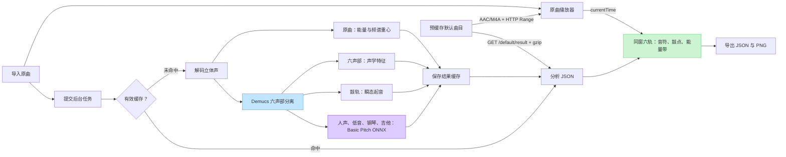

# Hya MVP 处理流程

所有分析在本机完成。后台单进程顺序执行模型任务，界面轮询阶段进度；可取消或超时结束。原始上传及中间音频随任务清理，分析 JSON 留在 `outputs/cache/`。

六声部都保存声学特征；主视图同步显示人声、低音、钢琴、吉他、鼓点及其他声部。播放采用原曲 `currentTime`，不重新合成 MIDI，也不同时播放六条分轨。快速分析模式独立走旧版 FFT 管线。

默认曲目通过 `precache.py` 先完成分析，再写入 `outputs/default/` 的音频副本与配置。页面打开时直接设置轻量 AAC/M4A 播放地址，并独立读取 `outputs/cache/`；不传输原曲到浏览器再上传，不重新提交任务。播放器通过 Range / HEAD 支持移动 Safari 的按需加载与跳转；缓存返回 gzip 压缩 JSON。可视化加载失败不移除音频地址。
